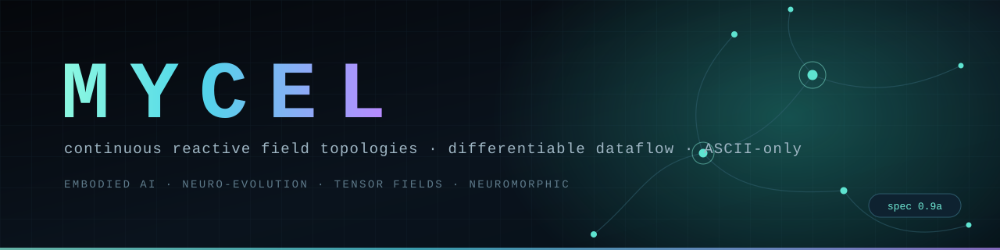
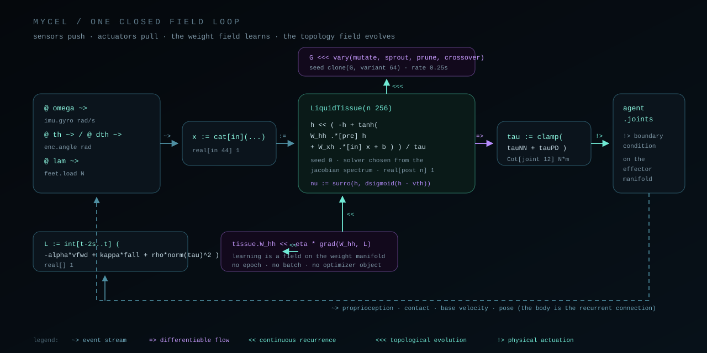
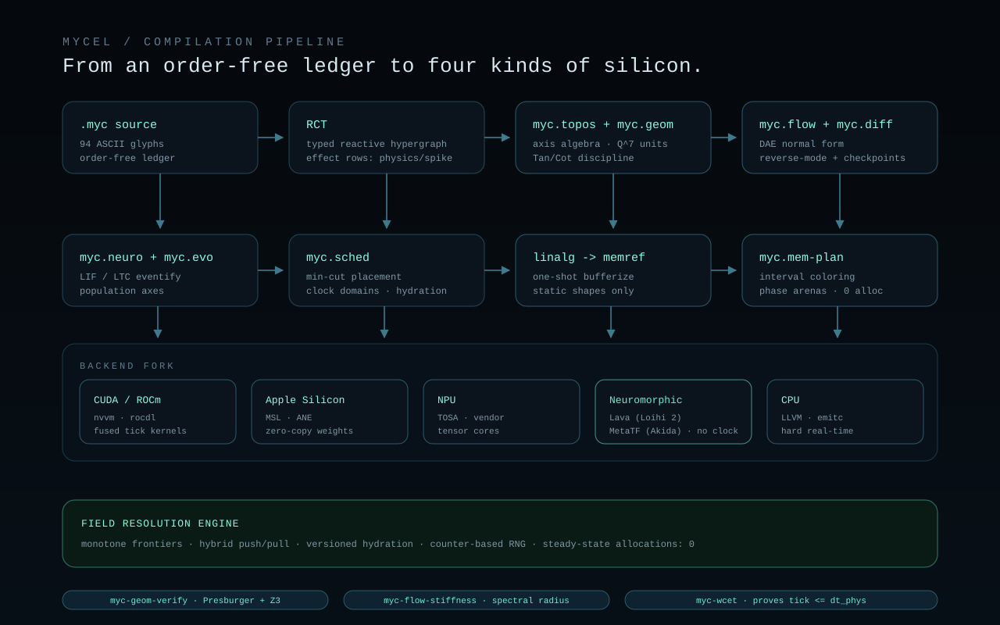

<p align="center">
  
</p>

<p align="center">
  <a href="https://github.com/urbanyl/mycel/actions/workflows/ci.yml"></a>
  <a href="LICENSE"></a>
  <a href="pyproject.toml"></a>
  <a href="docs/01-language-spec.md"></a>
  <a href="docs/01-language-spec.md"></a>
  <a href="docs/00-philosophy.md"></a>
  <a href="https://github.com/urbanyl/mycel/stargazers"></a>
  <a href="https://github.com/urbanyl/mycel/commits/main"></a>
  <a href="https://github.com/urbanyl/mycel/issues"></a>
</p>

<p align="center">
  <b>A programming language where a program is a world, not a recipe.</b><br>
  Continuous reactive field topologies &middot; differentiable dataflow &middot;<br>
  neuro-evolution &middot; neuromorphic backends &middot; zero steady-state allocations.
</p>

---

## What is MYCEL?

**MYCEL** (*Mycelial Reactive Field Language*) is a design specification for an AI-native
language that abandons the program counter entirely.

A `.myc` file is not a sequence of instructions. It is a **ledger** of fields: each line
*asserts* that some quantity is the solution of an equation, is streamed from a sensor, is
differentiable, evolves structurally, or is written to the world. Reordering the lines
changes nothing. There is no `main`, no `return`, and nothing to step through.

```myc
# A first-order lag, stated. Not iterated.
@ tint  << ( ambient - tint ) / tau     seed 293.15   : real[] K

# A gradient descent, stated. Not looped.
@ W_hh  << -eta * grad( W_hh , L )                    : real[post n, pre n] 1

# A topology search, stated. Not spawned.
@ G     <<< vary( mutate 0.02 , sprout , prune )      seed clone(G, variant 64)
```

`<<` is not a loop. It is the **solution operator of an ordinary differential equation**.
The compiler decides whether that becomes an RK4 kernel on a GPU, a semi-implicit solver on
a CPU, or a free-running population of leaky compartments on a neuromorphic die.

### The five axioms

| | Axiom | Consequence |
|---|---|---|
| **A1** | A program is a world, not a recipe | Order-free ledger; no entry point; no `main` |
| **A2** | Time is a dimension, not a control construct | `<<` is an ODE; populations are axes; no `for` |
| **A3** | Branching is routing | `x \| p`, `argmax[a]`, and `a * gate` replace `if` |
| **A4** | Every differentiable edge is auto-adjoint | `=>` carries a cotangent slot; no tape, no `backward()` |
| **A5** | Nothing is allocated at runtime | Static arenas, colouring, ring buffers; **0 allocations per tick** |

---

## ASCII-only, on purpose

The source alphabet is exactly the **94 printable ASCII code points**. Every operator is
typeable on any keyboard, survives `grep`, diffs cleanly, and needs no special font.

```myc
<<<   >>    <<    ~>    =>    !>    :=    ~~    ||    ..
.*    **    ~*    ++    >=    <=    ==    !=    @ % $ > | ? ! ^
```

Nothing else is legal in code. `;`, `{` and `}` are lexical errors (`MYC0102`), and any
byte outside ASCII raises `MYC0101` before parsing even begins.

### Operators

| Token | Name | Meaning |
|---|---|---|
| `:=` | bind | Timeless definition; implicit genesis of a later `<<` |
| `~>` | synapse | Event stream / spikes. **Not differentiable** (implicit cut) |
| `=>` | flow | Differentiable stream; allocates a cotangent slot |
| `<<` | recur | Continuous state: `h << f` asserts `dh/dt = f` |
| `<<<` | evolve | Structural evolution on a slow timescale |
| `!>` | actuate | Boundary condition on a physical effector |
| `*` | gate | Elementwise; axes must be **identical** (no broadcasting) |
| `.*[a]` | contract | Sum over the named axis `a` |
| `**` | outer | Tensor product over **disjoint** axes |
| `~*` | manifold | Geometric / convolutional product under a metric |
| `++` | fuse | Topological union of hypergraphs sharing ports |
| `>>[a]` | reindex | Layout / label change; free at runtime |
| `grad(x, L)` | gradient | Reverse-mode query over the cotangent bundle |
| `int[a..b]` | integral | Measure integral; replaces accumulation loops |
| `argmax[a]` | select | Rank selection; replaces branching |
| `x \| p` | guard | Defined only where the predicate holds |
| `?` | sample | Counter-based draw: `?N(0, 1)` |
| `cut(x)` / `surro(x, d)` | cut / surrogate | Explicit stop-gradient; pseudo-derivative for spikes |
| `~~` | adjoint | `f ~~ f_adj` declares an analytic adjoint |
| `\|\|` | hydrate | Versioned barrier between clock domains |

Full table: [`spec/operators.tsv`](spec/operators.tsv) &middot; grammar: [`spec/grammar.ebnf`](spec/grammar.ebnf)

---

## The type system earns its keep

Every value is `manifold[axis extent, ...] unit`, with units as rational exponent vectors
over `(kg, m, s, A, K, mol, cd)`:

```
real[batch B, time T, head H, proj 64] 1
Tan[joint 12] rad/s        # velocities live in the tangent bundle
Cot[joint 12] N*m          # torques live in the cotangent bundle
real[] W                   # power = kg*m^2/s^3
```

`Tan` and `Cot` **never unify**. Their only legal combination is `pair(tau, dth)`, which
yields mechanical power. That single rule eliminates the classic robotics failure mode of
applying a Jacobian instead of its transpose.

```
error[MYC0402]: cannot unify Cot[joint 12] with Tan[joint 12]
  = note: did you mean pair(tau, dth)? it yields real[] W
```

Axes are **named**, so `(B, T, H, D)` and `(B, H, T, D)` are different types, and silent
broadcasting is impossible. All checks are erased before codegen: **zero runtime cost**.

Read: [02 - Type System](docs/02-type-system.md)

---

## Two worked examples

<p align="center">
  
</p>

**[`examples/01-biped-walker.myc`](examples/01-biped-walker.myc)** - a 12-DoF biped with
IMU, joint encoders and foot contacts, driving a liquid time-constant neural tissue, trained
online by gradient flow on the weight manifold, with neuro-evolutionary topology search
running at 0.25 Hz. No gait state machine, no epoch, no optimizer object.

```myc
@ tauNN := cat[in]( y , clk ) .*[in] W_m       : Cot[joint 12] N*m
@ tauPD := metric_Q( Kp*(thref-th) + Kd*(0-dth) ) : Cot[joint 12] N*m
@ tau   := clamp( tauNN + tauPD , tau_max ) * balance(q, lam)
@ tau   !> agent.joints
```

**[`examples/02-transformer-block.myc`](examples/02-transformer-block.myc)** - multi-head
self-attention as a manifold field. No PyTorch, no JAX, no tape.

```myc
@ Q  := X .*[embed] Wq                                   : real[batch B, time T, head H, proj 64] 1
@ S  := ( Q .*[proj] K ) / sqrt(64) | time >= key        : real[batch B, head H, time T, key T] 1
@ Pp := softmax[key]( S )
@ A  := Pp .*[key] V
```

Also: [`03-thermostat.myc`](examples/03-thermostat.myc) (branch-free hysteresis, learning,
evolution) and [`04-hello-field.myc`](examples/04-hello-field.myc) (the smallest real MYCEL
program).

---

## Architecture

<p align="center">
  
</p>

```
.myc ledger -> RCT -> myc.topos -> myc.geom -> myc.flow -> myc.diff
             -> myc.neuro / myc.evo -> linalg -> memref -> myc.mem-plan
             -> CUDA | ROCm | Metal | NPU (TOSA) | Loihi 2 (Lava) | Akida (MetaTF) | LLVM
```

Eight custom MLIR dialects, a Presburger-based geometry verifier, a stiffness analyser that
picks integrators per field, reverse-mode lowering with a checkpointing knapsack, and a
static memory planner that ships **aliasing and WCET certificates** with every artifact.

Read: [03 - Compiler Pipeline](docs/03-compiler-pipeline.md) &middot;
[04 - Hardware Backends](docs/04-hardware-backends.md) &middot;
[05 - Memory Model](docs/05-memory-model.md)

---

## Install and run

The reference **front end** is pure Python with no dependencies: lexer, ledger parser, SI
unit algebra, axis algebra, static checker and CLI.

```bash
git clone https://github.com/urbanyl/mycel.git
cd mycel
pip install -e ".[dev]"

mycel check examples/01-biped-walker.myc
mycel ast   examples/04-hello-field.myc
mycel units "N*m"
```

```
$ mycel units "N*m"
input      : N*m
normalised : kg*m^2/s^2
exponents  : ('1', '2', '-2', '0', '0', '0', '0')

$ mycel check examples/01-biped-walker.myc
  ok - every obligation discharged
```

```bash
pytest            # 59 tests
```

---

## Repository map

```
assets/          banner, logo, architecture and field-topology diagrams (SVG)
docs/            00 philosophy .. 08 roadmap
examples/        four .myc programs, from hello-field to the biped
mycel/           reference front end: lexer, parser, units, axes, checker, CLI
spec/            grammar.ebnf and operators.tsv (normative)
tests/           unit and conformance tests
```

---

## Status: what exists, what is designed

Intellectual honesty, stated up front.

| Layer | Status |
|---|---|
| Axioms and denotational semantics | ✅ specified |
| ASCII surface syntax and operator algebra | ✅ specified |
| SGTS: named axes, `Q^7` units, `Tan`/`Cot` | ✅ specified, ✅ implemented (units + axes) |
| Reference lexer / parser / checker / CLI | ✅ implemented and tested |
| Four worked `.myc` programs | ✅ parse and pass every static obligation |
| MLIR dialect set (8 dialects) | 📐 specified, not implemented |
| `myc-flow` integrators, `myc-diff` lowering | 📐 specified |
| GPU / Metal / NPU / Loihi / Akida backends | 📐 specified |
| Static memory planner and certificates | 📐 specified |

This repository is a **specification that can be tested**, not a compiler you can ship to a
robot today. See [08 - Roadmap](docs/08-roadmap.md) for the order in which that changes.

---

## Documentation

| | |
|---|---|
| [00 - Philosophy](docs/00-philosophy.md) | Why the program counter has to go |
| [01 - Language Specification](docs/01-language-spec.md) | Tokens, grammar, connectives, roles |
| [02 - Type System](docs/02-type-system.md) | Axes, units, `Tan`/`Cot`, effects, erasure |
| [03 - Compiler Pipeline](docs/03-compiler-pipeline.md) | Dialects, passes, artifacts |
| [04 - Hardware Backends](docs/04-hardware-backends.md) | CUDA, Metal, NPU, Loihi 2, Akida |
| [05 - Memory Model](docs/05-memory-model.md) | Arenas, colouring, checkpoints, rings |
| [06 - Standard Fields](docs/06-standard-fields.md) | Builtins and combinators |
| [07 - FAQ](docs/07-faq.md) | "How do you write a counter?" |
| [08 - Roadmap](docs/08-roadmap.md) | v0.10 to v1.0, plus non-goals |

---

## Contributing

The highest-value contributions right now are **adversarial examples**: a `.myc` file that
*should* compile and does not, or one that should *not* and does. See
[CONTRIBUTING.md](CONTRIBUTING.md).

## License

MIT. See [LICENSE](LICENSE).

<p align="center">
  <sub>
    <i>Mycelium is the hyphal lattice of a fungus: a network with no centre that routes
    toward demand, remembers past scarcity in its own geometry, and rewires itself
    continuously while remaining a single organism.</i><br>
    <i>It also reads as "my cell".</i>
  </sub>
</p>
