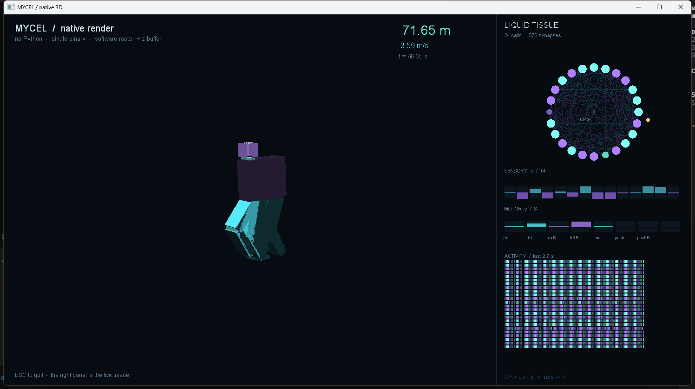

# 09 — Native Rendering

MYCEL ships rendering as a **backend**, not as a library call. A ledger
that declares a view is lowered to a self-contained executable: one
binary, no interpreter, no Python, no third-party DLLs.

```
examples/06-biped-native.myc
        │  mycel build
        ▼
   build/walker3d/main.go      (generated)
   build/walker3d/policy.go    (weights baked in)
        │  go build -trimpath -ldflags "-s -w"
        ▼
   build/walker3d/walker3d.exe      1.7 MiB
```

The runtime is [`runtime/myc`](../runtime/myc): pure Go, standard library
only, talking to `user32`/`gdi32` through `syscall`. Nothing else is
linked.

---

## 1. Surface syntax

Rendering is declared with `$` directives and ordinary fields. There is no
render loop to write and no callback to register.

```myc
$ view   1280x720 title "MYCEL / native 3D"
$ style  3d
$ camera at [4.2,1.9,-5.0] look [0,0.75,0] fov 38 follow 4.2
$ body   Biped2D
$ policy ../runs/demo/theta.npz
$ name   walker3d

@ cmd     := y              : real[out 8] 1
@ cmd     !> body.commands
@ present !> view.present
```

| Directive | Meaning |
|---|---|
| `$ view WxH title "..."` | window size and caption |
| `$ style 2d \| 3d` | projection preset |
| `$ camera at [x,y,z] look [x,y,z] fov F follow D` | camera; `follow` tracks the body along X |
| `$ body Biped2D` | body primitive from the native standard library |
| `$ policy file.npz` | weights baked into the binary at build time |
| `$ name N` | artifact name (`build/N/N.exe`) |

`!> view.present` is the only operation that touches the swap chain. A
render graph is therefore just another sink, and the same dead-code
elimination that removes unused fields removes unused draw calls.

---

## 2. Runtime architecture

```
Win32 window ─► DIB section (32 bpp, top-down)
                     │
                     ├─ software rasteriser (z-buffered triangles)
                     ├─ 2D overlay (lines, discs, rectangles)
                     └─ GDI text (TextOutA into the same bits)
                     │
                BitBlt ─► window DC          ~60 Hz, QueryPerformanceCounter
```

* **No GPU API.** The rasteriser is ~200 lines: edge functions, barycentric
  coverage, a `float32` depth buffer. It is fast enough for a few thousand
  triangles and it never fails on a driver.
* **Text without a font file.** `CreateFontA("Consolas")` + `TextOutA`
  writes straight into the DIB, so there is no atlas to ship.
* **No allocation per frame.** The framebuffer is mapped once; the text
  queue is reused; the motion trail is a fixed ring.
* **Deterministic timing.** The simulation is stepped at a fixed 240 Hz
  and the renderer interpolates by frame time, so the gait does not depend
  on the monitor refresh rate.

Measured on the reference machine, 1280×720:

| | |
|---|---|
| frame time | 2.1–3.4 ms |
| sustained | 60 fps (vsync-free loop) |
| resident memory | ~14 MiB |
| binary | 1.66 MiB |

---

## 3. The tissue panel

`$ panel brain` splits the window: 3D scene on the left, the live neural
tissue on the right. Everything in the panel is computed from the same
`Controller` state the body is driven by — there is no second simulation.

```
LIQUID TISSUE            24 cells, 576 synapses
  ring           one node per cell, radius and colour by |h|
  edges          synapses with |W_ij| > 0.16, cyan excitatory, violet inhibitory
  CPG            the phase marker orbiting the ring
SENSORY x / 14   the input vector, live
MOTOR   y / 8    the command vector, with the semantic labels
ACTIVITY         a 24-row raster of the last 160 frames
```

<p align="center"></p>

The panel is drawn with the same primitives as the 3D scene (`Disc`,
`Line2D`, `Rect`), so it costs nothing beyond the pixels it covers.

---

## 4. What "natively in the language" means here

The ledger owns three things and the backend owns none of them:

1. **The view** — size, style, camera, what is on screen.
2. **The simulation** — the tissue, the ODE, the command vector.
3. **The graph** — which field reaches which sink.

The backend only knows how to turn a triangle into pixels. That is the
same split as `myc.flow` lowering an ODE to RK4: the semantics live in the
language, the arithmetic lives in the runtime.

The biped's controller is not re-implemented in the backend as a special
case. `mycel build` bakes the 1168 parameters of the ledger's tissue into
`policy.go`, and `runtime/myc/biped.go` evaluates exactly the equations the
ledger declares:

```
tau * dh/dt = -h + tanh( W .*[pre] (h >>[post:pre]) + U .*[in] x + b )
y           = clamp( W_out .*[post] h + G_ph .*[phase] cpg + b_out , 1 )
```

---

## 5. 2D mode

`$ style 2d` repositions the camera on the XY plane and disables the
ground grid; everything else is identical. Because the rasteriser is
already z-buffered, a 2D ledger can still be layered without draw-order
bookkeeping.

```myc
$ view 960x540 title "MYCEL / 2D"
$ style 2d
$ camera at [0,0.72,-8.6] look [0,0.72,0] fov 26
```

---

## 6. Roadmap

The software path is the correctness reference. The GPU path comes next
and must agree with it pixel-for-pixel on a fixed scene:

- [ ] `myc.render.gpu` dialect
- [ ] D3D11 backend (Windows), Vulkan backend (Linux)
- [ ] instanced beams, so a population of 64 walkers costs one draw call
- [ ] `sprite` and `mesh` primitives loaded from asset IDs
- [ ] offscreen render targets, for `view.capture`

The interface is already shaped for it: `Gfx` is an interface-shaped
struct with `Clear`, `Tri`, `Beam`, `Box`, `Line2D`, `Text`. A GPU
backend implements the same six calls.
